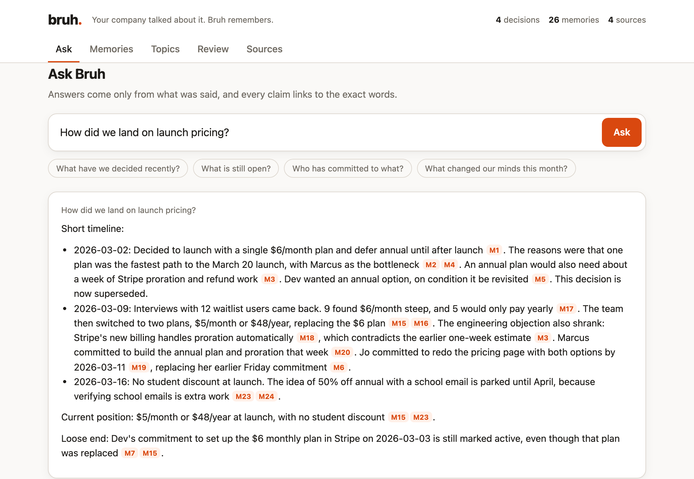
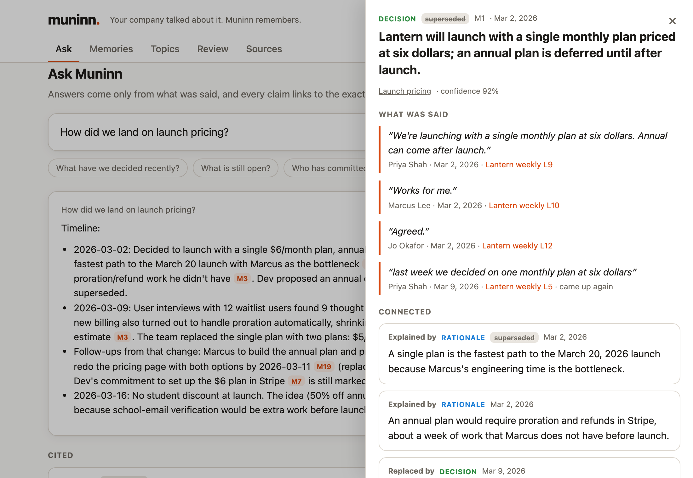
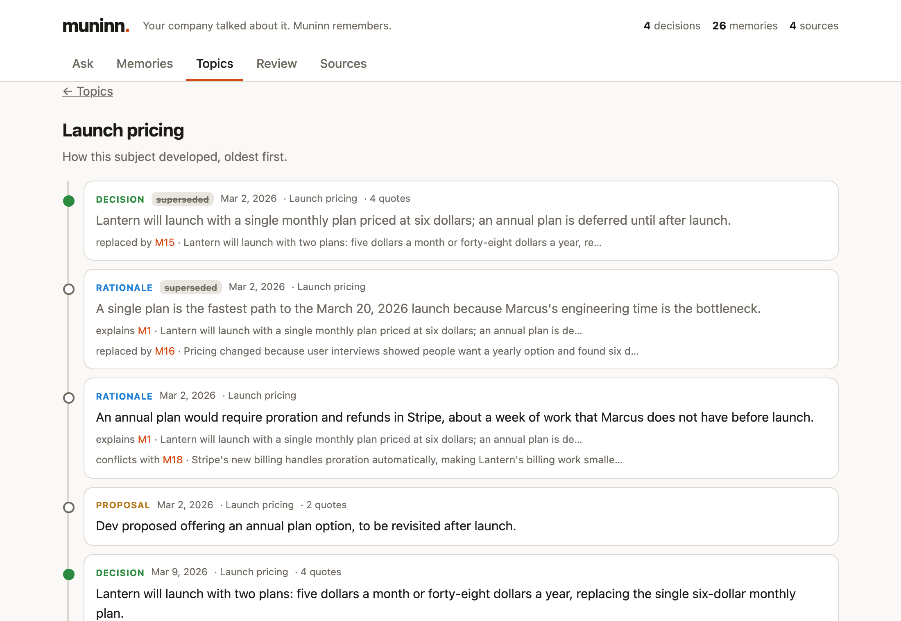

<p align="center">
  <picture>
    <source media="(prefers-color-scheme: dark)" srcset="assets/logo-dark.svg">
    
  </picture>
</p>

<p align="center">
  <em>Bruh. We decided this in March.</em>
</p>

<p align="center">
  
  
  
  
</p>

<p align="center">
  <picture>
    <source media="(prefers-color-scheme: dark)" srcset="assets/ask-dark.png">
    
  </picture>
</p>

---

You know the one. In every meeting. Lurks in every channel. Never says much.

Three weeks later someone asks *"wait, when did we decide that?"* and they slide over a link. To the exact words. Who said it. When. And the meeting where the team quietly changed its mind.

Bruh is that coworker, as open-source software. It reads your team's meeting transcripts and Slack and keeps a cited record of what you **decided**, **why**, who **committed** to what, and what's still **open**.

## The receipts

Every claim links to the words that support it. Not a summary of a summary. The actual words.

<p align="center">
  <picture>
    <source media="(prefers-color-scheme: dark)" srcset="assets/receipts-dark.png">
    
  </picture>
</p>

## It knows when you changed your mind

Decisions get reversed. Bruh doesn't overwrite the old one. It keeps both, links them, and tells you what replaced what and why.

<p align="center">
  <picture>
    <source media="(prefers-color-scheme: dark)" srcset="assets/timeline-dark.png">
    
  </picture>
</p>

## It knows when you're kidding

From the demo team's actual pricing meeting:

> **Dev:** Or we go full premium and charge six hundred a month. Very exclusive habits.<br>
> **Marcus:** Last thing, imagine if we did lifetime deals, we'd make rent in a week. Not proposing it, just saying.<br>
> **Marcus** (in Slack): oh great, timezones, my favorite thing in the world 🙃

Bruh recorded none of that. It labels jokes, hypotheticals and quotes of other people, and it never cites them as evidence. It also won't count three 👍 reactions as a decision, won't let a bot decide anything, and doesn't keep "the PR is merged" as organizational wisdom.

## Try it

You need [uv](https://docs.astral.sh/uv/) and an [Anthropic API key](https://console.anthropic.com/).

```sh
git clone https://github.com/TheCraigHewitt/bruh && cd bruh
cp .env.example .env    # paste your API key in here

# meet Lantern, a made-up four-person startup with three meetings and a Slack channel
uv run --env-file .env bruh ingest examples/lantern/*.txt examples/lantern/slack
uv run --env-file .env bruh serve
```

Open http://127.0.0.1:8765 and ask it something. The demo costs about 30¢ in API calls.

**Then point it at your own team:**

- **Meeting transcripts** as `.txt`, one turn per line: `Speaker: words`. The header that meeting-notes apps export (`Meeting Title:`, `Date:`, `Meeting participants:`, `Transcript:`) is understood. Put the date in the file name (`standup-2026-03-02.txt`).
- **Slack:** *Workspace settings → Import/Export Data → Export*, unzip, and point Bruh at the folder.

Everything Bruh stores lives in `data/`, which git ignores. Model responses are cached, so re-running costs nothing. `bruh spend` shows what you've spent so far.

Also from the terminal: `bruh ask "what did we decide about pricing?"` and `bruh review` for anything waiting on a human.

## Leave it running

Exports are fine for a first look. Bruh's better when it's just *there*.

**In Slack.** Invite `@bruh` to a channel and it follows along, reading what was said once the conversation goes quiet. Then anyone can ask:

> **you:** @bruh what are we charging at launch?<br>
> **bruh:** Two plans at launch: $5/month or $48/year [1]. It was a single $6/month plan until Mar 9 [2].<br>
> **Receipts**<br>
> **[1]** Decision · Mar 9, 2026<br>
> "Then we're changing it. Launch with five dollars a month, or forty-eight dollars a year." — Priya Shah, Lantern weekly (Mar 9, 2026)

Setting it up takes about 10 minutes and a Slack admin: [`docs/SLACK.md`](docs/SLACK.md).

**A transcript folder.** Point Bruh at the folder your meeting-notes app exports to, and every new transcript gets read as it lands:

```sh
uv run --env-file .env bruh serve --slack --watch ~/Transcripts   # web app + Slack + folder, all at once
```

## How it works

1. **Read.** Each conversation is split into numbered lines with a speaker and a time.
2. **Sniff test.** Every line gets labelled: sincere, joking, hypothetical, or quoting someone else. Only sincere lines can be evidence.
3. **Extract.** Decisions, proposals, reasons, commitments, facts and open questions, each with exact quotes. Any quote that isn't word-for-word gets thrown out.
4. **Reconcile.** Each new memory is compared with what Bruh already knows: a repeat adds evidence, a reversal supersedes, a conflict gets linked. Everything is filed under a topic.
5. **Ask for help.** If Bruh isn't sure something was really decided, it goes to the Review tab for a human to confirm. Only people make decisions.
6. **Answer.** Questions are answered from the record only, with citations Bruh checks before showing you.

## Rules it lives by

- **Receipts or it didn't happen.** Every claim traces back to the exact words.
- **History is never rewritten.** A reversed decision stays on the record, marked replaced.
- **Only people decide.** Jokes, hypotheticals, emoji and bots never become decisions.
- **No DMs.** Ever.
- **Your data stays yours.** Runs on your machine. Nothing is committed, nothing is hosted.

## Status

v0 runs on one machine for one team: exported files, a transcript folder, and a Slack bot. Everyone who can ask it can hear about everything it's read, so only feed it what the whole team could see anyway. The full design (Google Meet without the export step, sign-in, per-channel permissions, an MCP server so agents can use the same memory) is written up in [`docs/`](docs/). Start with [`docs/V0.md`](docs/V0.md) for what's built and what isn't.

```sh
uv run pytest                          # offline tests, no API calls
uv run --env-file .env bruh eval       # extraction checks against the real model
```

Issues and ideas welcome.

## License

[Apache-2.0](LICENSE)

---

<p align="center"><sub>Bruh won't say "I told you so." Bruh will send you a link to where it told you so.</sub></p>
